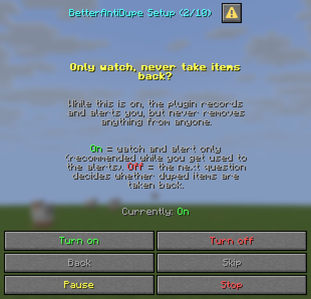
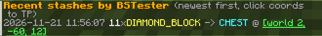

 

**Stops item duplication on your Minecraft server, and tells you who tried.**

Better Anti-Dupe watches the items themselves.  
It keeps a record of every valuable item a player gains and loses.

When something's up, you are notified with a list of where  
they put the items, and a **[click to teleport]** there.

Install it and you are protected. The defaults are sensible, and nothing is ever taken from a player until you decide it should be.

---

## Will it work on my server?

| | |
|---|---|
| **Server software** | Paper, Folia, Spigot, or a Paper fork |
| **Minecraft** | 1.21.x and 26.x, all with the same download |
| **Java** | 21+ for `1.21.x` or 25+ for `26.x` |
| **Anything else** | Nothing. Redis is optional. |

<b>Which download do I need?</b>

There is only one. The same jar works on every supported Minecraft version and picks the right support for your server when it starts.  

More info? [Read about it in the docs](https://esmp-fun.gitbook.io/plugins/better-anti-dupe/getting-started/install)

---

## What it blocks

The classic dupe machines stop working the moment you install the plugin.  
Each one has its own switch, in case you want to allow it.

<b>Rail and carpet dupers</b>

One of the oldest dupes in the game.  
All it needs is a piston and a rail or carpet.  
With Better Anti-Dupe, these dupe machines are disabled by default.

More info? [Read about it in the docs](https://esmp-fun.gitbook.io/plugins/better-anti-dupe/using-it/what-it-blocks-and-catches)

<b>TNT dupers</b>

TNT dupers power world eaters and flying machines.  
They stop working from day one.  
Running an anarchy or tech server? One switch turns them back on.

More info? [Read about it in the docs](https://esmp-fun.gitbook.io/plugins/better-anti-dupe/using-it/what-it-blocks-and-catches)

<b>Sand and gravel portal dupers</b>

Sand and gravel can no longer be copied through a portal.  
Farms and flying machines that push sand keep working.

More info? [Read about it in the docs](https://esmp-fun.gitbook.io/plugins/better-anti-dupe/using-it/what-it-blocks-and-catches)

<b>Ghost chest windows</b>

A player can't keep taking items from a chest that's already gone.  
The window simply closes.  
Nobody playing normally will ever notice.

More info? [Read about it in the docs](https://esmp-fun.gitbook.io/plugins/better-anti-dupe/using-it/what-it-blocks-and-catches)

<b>Hidden menu dupes</b>

Most dupes in other plugins (backpacks, ender chests, storage menus) start the same way: a cheat client hides the menu on screen without telling the server it closed.  
Mining, building, hitting, dropping, swapping hands, switching slots, or running a command while a menu is still open is stopped, the menu closes, and staff get an alert.  
Actions in the first second after a menu opens are always allowed so lag never trips it.

More info? [Read about it in the docs](https://esmp-fun.gitbook.io/plugins/better-anti-dupe/using-it/what-it-blocks-and-catches)

<b>Chest copies from blocked placements</b>

When a land-claim or protection plugin blocks a placement that already spilled a container (such as the last eye of ender over a chest in an end portal), the container comes back while a copy drops on the ground.  
Better Anti-Dupe puts everything back and clears the copy, so the container keeps its items and nothing is doubled.

More info? [Read about it in the docs](https://esmp-fun.gitbook.io/plugins/better-anti-dupe/using-it/what-it-blocks-and-catches)

<b>Restart dupes</b>

No machine needed, just good timing during a restart.  
Every open window closes as the server shuts down.  
Nothing is left to copy.

More info? [Read about it in the docs](https://esmp-fun.gitbook.io/plugins/better-anti-dupe/using-it/what-it-blocks-and-catches)

## What it catches

Everything else. It notices when a player holds more than possible.

<b>Carrying more than they earned</b>

The heart of the plugin.  
It knows what each player earned, and counts what they hold.  
Shulker boxes, bundles, and sulfur cube buckets included. Holding more? You'll know.

More info? [Read about it in the docs](https://esmp-fun.gitbook.io/plugins/better-anti-dupe/using-it/what-it-blocks-and-catches)

<b>Faked owner marks</b>

Every mark the plugin puts on an item is signed with a secret only your server knows.  
Marks made by hand in creative mode, with an item editor, or by command do not verify, are ignored so nobody's record is touched, and raise an alert to staff.

More info? [Read about it in the docs](https://esmp-fun.gitbook.io/plugins/better-anti-dupe/using-it/what-it-blocks-and-catches)

<b>The same dropped item picked up twice</b>

Every dropped item is one of a kind.  
If the same one is picked up twice, it was copied.  
This is the most certain alert there is.

More info? [Read about it in the docs](https://esmp-fun.gitbook.io/plugins/better-anti-dupe/using-it/what-it-blocks-and-catches)

<b>More drops than a block or item frame gave</b>

Breaking a block or a frame drops a known amount.  
Picking up more than that nearby means something was copied.

More info? [Read about it in the docs](https://esmp-fun.gitbook.io/plugins/better-anti-dupe/using-it/what-it-blocks-and-catches)

<b>Small dupes hidden by storing them away</b>

Dupe a few items, hide them in a chest, and hope nobody notices.  
It's an old trick.  
Small amounts are remembered for a day, and they add up to an alert.

More info? [Read about it in the docs](https://esmp-fun.gitbook.io/plugins/better-anti-dupe/using-it/what-it-blocks-and-catches)

<b>Copies made inside a chest</b>

Some dupes never touch a player's inventory.  
The copies simply appear in a chest.  
You're told whose items they were, who took them, and where.

More info? [Read about it in the docs](https://esmp-fun.gitbook.io/plugins/better-anti-dupe/using-it/what-it-blocks-and-catches)

<b>Items washed through hoppers</b>

Dupers pass items through hoppers to make them look clean.  
The route is written down, so you can follow it.  
Or block hoppers from moving watched items at all.

More info? [Read about it in the docs](https://esmp-fun.gitbook.io/plugins/better-anti-dupe/using-it/what-it-blocks-and-catches)

<b>Gaining things impossibly fast</b>

You decide how many of an item anyone could honestly get in a minute.  
Going past it makes a player worth a closer look.

More info? [Read about it in the docs](https://esmp-fun.gitbook.io/plugins/better-anti-dupe/using-it/what-gets-tracked)

<b>Nobody ever seeing them get anything</b>

Duping usually happens alone.  
A player whose gains nobody ever sees becomes a little more suspicious.  
It never accuses anyone on its own.

More info? [Read about it in the docs](https://esmp-fun.gitbook.io/plugins/better-anti-dupe/using-it/what-it-blocks-and-catches)

<b>Someone editing the records</b>

Every record is sealed to the one before it.  
Even an admin can't quietly change history.  
One command shows exactly where it was touched.

More info? [Read about it in the docs](https://esmp-fun.gitbook.io/plugins/better-anti-dupe/using-it/what-it-blocks-and-catches)

Crafting, anvils, smithing tables, stonecutters, looms, cartography tables, grindstones, furnaces, villager trades, enchanting, chests, barrels, ender chests, shelves, decorated pots, lecterns, item frames, armor stands, animal chests, and sulfur cubes (26.2+). Everything is monitored.

---

## Made for staff, not just for detection

 

<b>Guided in-game setup (/adp setup)</b>

Run `/adp setup` in game to walk through the main settings one question at a time, starting with your language.  
On modern Paper servers it opens native Dialog screens; on Spigot and older builds it uses clickable chat buttons.  
Every answer saves to `config.yml` and starts working straight away.

More info? [Read about it in the docs](https://esmp-fun.gitbook.io/plugins/better-anti-dupe/getting-started/setup-tour)

<b>Find the stash</b>

Knowing someone duped is only half the job.  
One command lists where they put the items.  
Click the coordinates and you're there, even in another world.

More info? [Read about it in the docs](https://esmp-fun.gitbook.io/plugins/better-anti-dupe/using-it/when-an-alert-comes-in)

<b>Decide in five minutes</b>

Every alert has **[History]** and **[Stash]** buttons.  
Look, decide, done.  
Confirm a duper, clear a false alarm, accept a legitimate item, or take the extras back.

More info? [Read about it in the docs](https://esmp-fun.gitbook.io/plugins/better-anti-dupe/using-it/when-an-alert-comes-in)

<b>Alerts on your phone</b>

You don't have to be online to know.  
Discord, Telegram, Slack, or your own webhook.  
Only the serious alerts, and no spam. One command tests your setup.

More info? [Read about it in the docs](https://esmp-fun.gitbook.io/plugins/better-anti-dupe/using-it/alerts-outside-the-game)

<b>Watch first, act later</b>

Nothing is taken from anyone until you say so.  
Watch the alerts for a while. Once you trust them, turn on automatic removal.  
It only ever takes the extras, never a whole stack.

More info? [Read about it in the docs](https://esmp-fun.gitbook.io/plugins/better-anti-dupe/getting-started/watch-or-remove)

<b>Items stack normally (even from other plugins)</b>

Your players won't notice a thing.  
Watched items stack and trade like any other item.  
Items handed out by auction houses, shops, orders menus, crates, graves, or kits automatically pick up the new holder's mark, so they stack right away with items the player already owns.

More info? [Read about it in the docs](https://esmp-fun.gitbook.io/plugins/better-anti-dupe/using-it/other-plugins)

<b>Hidden from players</b>

Mods that show hidden item data see nothing, even inside shulker boxes, bundles, or sulfur cube buckets.  
A duper testing on two accounts can't tell which items are watched.

More info? [Read about it in the docs](https://esmp-fun.gitbook.io/plugins/better-anti-dupe/reference/settings)

<b>Available in your language</b>

English, Português do Brasil, Español, Deutsch, Русский and Polski are built in.  
Every message can be changed to your liking.

More info? [Read about it in the docs](https://esmp-fun.gitbook.io/plugins/better-anti-dupe/using-it/language-and-messages)

<b>Several servers?</b>

Items travel between servers on a network.  
Share records through Redis, and a dupe on one server is spotted on another.

More info? [Read about it in the docs](https://esmp-fun.gitbook.io/plugins/better-anti-dupe/getting-started/storage)

---

## Installation

1. Download the jar.
2. Drop it into `plugins/` and restart the server.
3. Optional: join the server and run `/adp setup` to walk through the main settings in game (or leave the defaults as they are).
4. That's it. [Testing in-game](https://esmp-fun.gitbook.io/plugins/better-anti-dupe/help/testing-in-game) shows you it working.

More info? [Read about it in the docs](https://esmp-fun.gitbook.io/plugins/better-anti-dupe/getting-started/install)

---

## Commands

Every command starts with `/adp`.

| Command | What it does |
|---|---|
| `/adp setup` | Guided tour of the main settings (`/adp setup continue` resumes) |
| `/adp ledger suspects` | Everyone currently suspected, worst first |
| `/adp ledger reconcile <player>` | Check what an online player carries right now |
| `/adp ledger history <player>` | Their last 15 records |
| `/adp ledger stash <player>` | Where they put the items, with click-to-teleport |
| `/adp ledger remove <player>` | Take back only the extras, after you confirm |
| `/adp ledger accept <player> <item> [amount]` | Record an item they earned fairly and clear its alert |
| `/adp ledger confirm <player>` | Mark a real duper |
| `/adp ledger clear <player>` | Mark a false alarm |
| `/adp ledger verify` | Check nobody has edited the records |
| `/adp fixstacks [player]` | Re-mark items so identical stacks merge again |
| `/adp marks` | Check owner mark signing status |
| `/adp reload` | Reload messages, alerts, and removal settings |
| `/adp test alert` | Send a test alert to chat and enabled channels |
| `/adp update check` / `download` | Check for updates and stage the next version |

`antidupe.alerts` only sees alerts.  
`antidupe.ledger` can use `/adp ledger` commands.  
`antidupe.admin.setup` can run `/adp setup`.  
`antidupe.admin` gets all of the above, plus reload, marks, fixstacks, test alerts, and updates.

More info? [Read about it in the docs](https://esmp-fun.gitbook.io/plugins/better-anti-dupe/reference/commands-and-permissions)

---

## Free and source available

This release is free, with no licence key required.  
The source is on [GitHub](https://github.com/ESMP-FUN/BetterAntiDupe), and issues and pull requests are welcome.

<b>Anonymous statistics</b>

Almost nobody opens a ticket, so I cannot tell which Minecraft versions run it.  
Knowing that helps me fight dupes on those versions first.

- **Sent:** your settings, versions, and counts of dupes caught, removed and blocked.
- **Never sent:** addresses, server names, player names, or anything from your records.
- **Kept private.** Public numbers would help dupers pick unprotected servers.
- **Error reports** are cleaned of passwords, tokens and ids before they leave your server.

Set `metrics.enabled: false` to send nothing at all.  
Nothing is ever shared, sold, or made public.

More info? [Read about it in the docs](https://esmp-fun.gitbook.io/plugins/better-anti-dupe/reference/settings)

> I take your privacy very seriously. Read the [company privacy policy](https://esmp.fun/plugins/privacy.php).

---

## Links

- **Guide**: [esmp-fun.gitbook.io/plugins/better-anti-dupe](https://esmp-fun.gitbook.io/plugins/better-anti-dupe)
- **Troubleshooting**: [common problems](https://esmp-fun.gitbook.io/plugins/better-anti-dupe/help/troubleshooting)
- **Source and issues**: [github.com/ESMP-FUN/BetterAntiDupe](https://github.com/ESMP-FUN/BetterAntiDupe)
- **Changelog**: [CHANGELOG.md](https://github.com/ESMP-FUN/BetterAntiDupe/blob/master/CHANGELOG.md)
