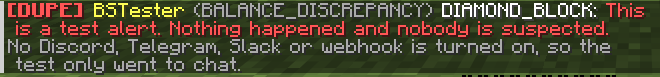

# Your first alert

This page shows you what an alert looks like before a real one comes in, and
makes sure your staff can see it.

## Step 1 - Send a test alert

In game, as an operator, run:

```
/adp test alert
```

A test alert shows in your chat:

<figure><figcaption></figcaption></figure>

It says nothing happened and nobody is suspected. Only you see it in game, and
it also goes to any Discord, Telegram or Slack you filled in. The lines under it
say which channels got it.

## Step 2 - Read the line

A real alert has the same shape:

```
[DUPE] Steve (BALANCE_DISCREPANCY) DIAMOND_BLOCK: Has 20 but ledger shows 12 (excess: 8)
```

* **Steve** is the player.
* **BALANCE_DISCREPANCY** is the kind of alert. This one means "carrying more
  than their record can explain". [When an alert comes
  in](../using-it/when-an-alert-comes-in.md#other-alerts-you-may-see) lists the
  others.
* **DIAMOND_BLOCK** is the item, in the name Minecraft uses in `/give`.
* **Has 20 but ledger shows 12** is the reason: 8 diamond blocks nobody saw
  them get.

A real alert reaches every admin in game. For staff who can use the
`/adp ledger` commands it ends with two buttons: **[History]** and **[Stash]**
show what the player gained lately and
where they put tracked items.

## Step 3 - Let your staff see alerts

Operators see alerts already. For moderators who are not operators, give them
one permission with your permissions plugin, for example LuckPerms:

```
/lp group moderator permission set antidupe.alerts true
```

`antidupe.alerts` shows alerts and nothing else. `antidupe.ledger` also lets
them look into a player. [Commands &
permissions](../reference/commands-and-permissions.md) has the full list.


**Only testing on your own?** Being an operator is enough. You can skip this
step.


Next: [When an alert comes in](../using-it/when-an-alert-comes-in.md).
