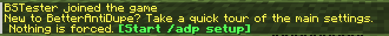
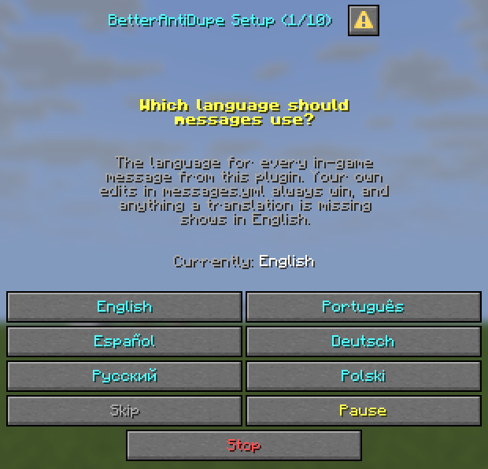
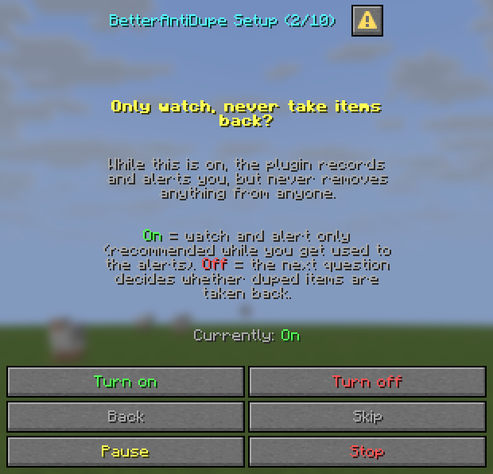
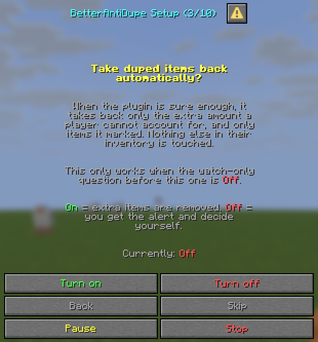
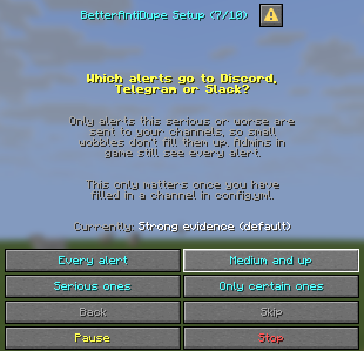
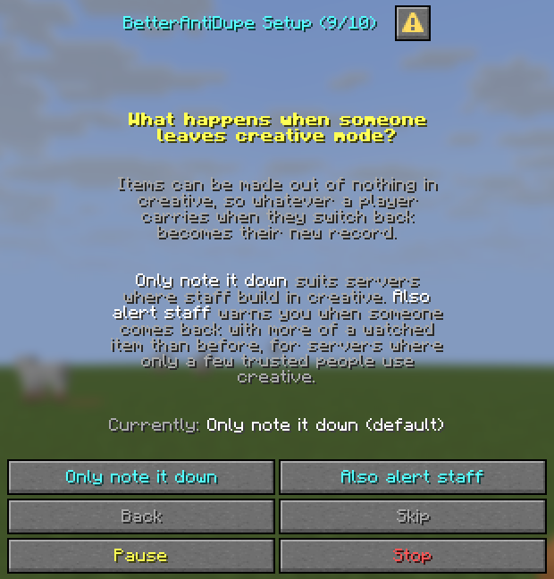
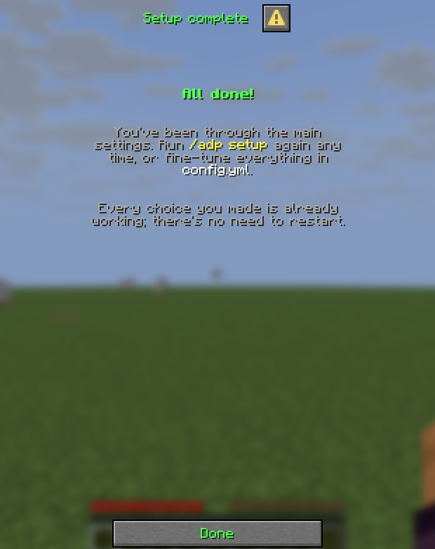

# Run the setup tour

The tour asks you about the plugin's main settings one at a time, in plain
words, and saves each answer for you. It takes about two minutes, and every
answer works straight away, with no restart.

You can skip it. The plugin already protects your server with its defaults,
and the tour never asks you to change anything.

## Step 1 - Start the tour

The first time an operator joins after the install, a reminder shows in chat:

<figure><figcaption></figcaption></figure>

Click **[Start /adp setup]**, or type:

```
/adp setup
```

A window opens over the game with the first question, the language for the
plugin's messages:

<figure><figcaption></figcaption></figure>

Click yours. Emerald SMP keeps **English**.

Every question looks the same:

* **The top line** shows where you are, here question 1 of 10.
* **The yellow line** is the question, with what each answer does underneath.
* **Currently** shows what the setting is right now.
* **Turn on** and **Turn off**, or a row of choices, save your answer and go to
  the next question.
* **Skip** goes on without changing anything, and **Back** goes back one.
* **Pause** closes the tour. `/adp setup continue` carries on where you
  stopped. **Stop** ends it.


**On Spigot, or Paper older than Minecraft 1.21.7?** The game has no such
windows there, so the tour runs in chat instead, with the same questions and
the same buttons as clickable text.


## Step 2 - Watch first

Questions 2 and 3 decide whether the plugin ever takes items off a player.

**Only watch, never take items back?** Click **Turn on**. The plugin records
and alerts you, and never removes anything.

<figure><figcaption></figcaption></figure>

**Take duped items back automatically?** Click **Turn off** for now.

<figure><figcaption></figcaption></figure>


**That is the safe start.** Watch the alerts for a week or two. Once you trust
what they find, come back and turn removal on. [Watch only, or take dupes
back](watch-or-remove.md) explains both switches.


Questions 4 to 6 (how sure it must be, how many items at once, whether the
player is told) only matter once removal is on. **Skip** them for now.

## Step 3 - Pick which alerts reach your channels

Questions 7 and 8 are about alerts in Discord, Telegram or Slack:

<figure><figcaption></figcaption></figure>

* **Which alerts go to Discord, Telegram or Slack?** **Medium and up** is a
  good start. Admins in game still see every alert.
* **How long between repeat alerts?** The default, **30 seconds**, already
  stops one incident from becoming fifty messages. **Skip** it.

Have no channel set up yet? Your answers wait until you do.
[Alerts in Discord, Telegram or Slack](../using-it/alerts-outside-the-game.md)
shows how.

## Step 4 - Creative mode

Items can be made out of nothing in creative mode, so the plugin needs to know
how to treat someone who switches back to survival:

<figure><figcaption></figcaption></figure>

* **Only note it down** suits a server where staff build in creative.
* **Also alert staff** warns you when someone comes back with more of a watched
  item than before. Pick it when only a few trusted people use creative.

## Step 5 - Finish

The last question is **Close open menus when the server stops?** Click **Turn
on**. It stops one kind of restart dupe and costs nothing.

The tour ends with a short "All done!" window. Click **Done**. Run `/adp setup`
again any time to change an answer.

<figure><figcaption></figcaption></figure>


**Can't run the tour?** It needs the `antidupe.admin` or
`antidupe.admin.setup` permission, and it runs in game only, not from the
console. Every question is also a line in `config.yml`; the page for each topic
names it.


Next: [Watch only, or take dupes back](watch-or-remove.md).
